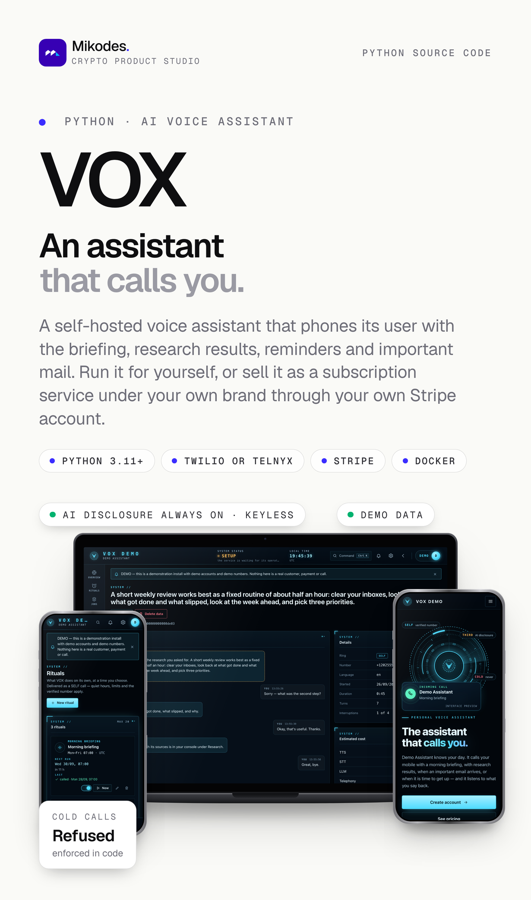
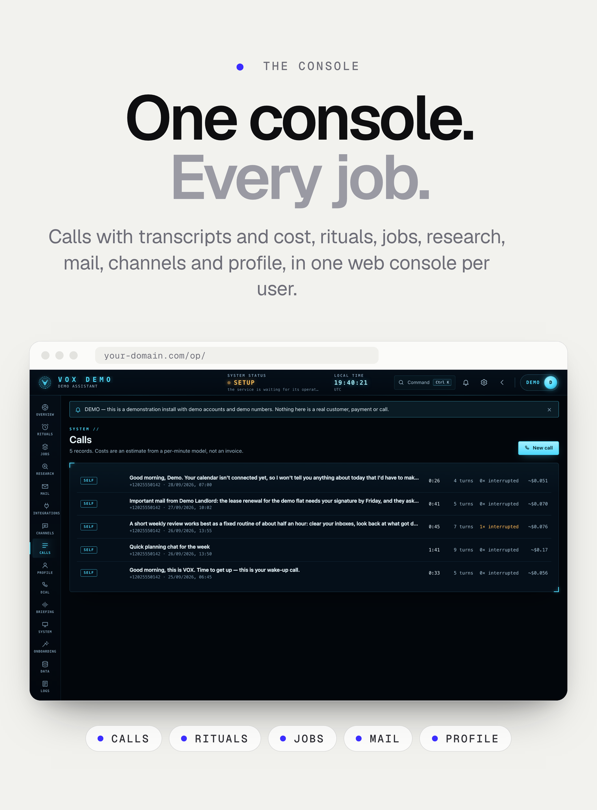
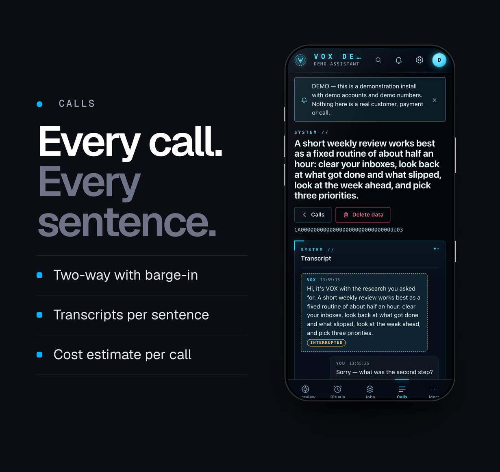
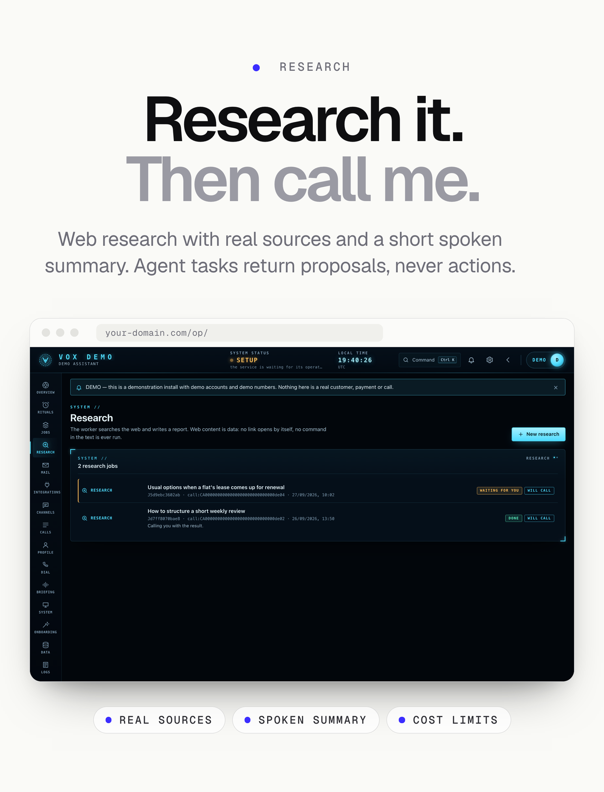
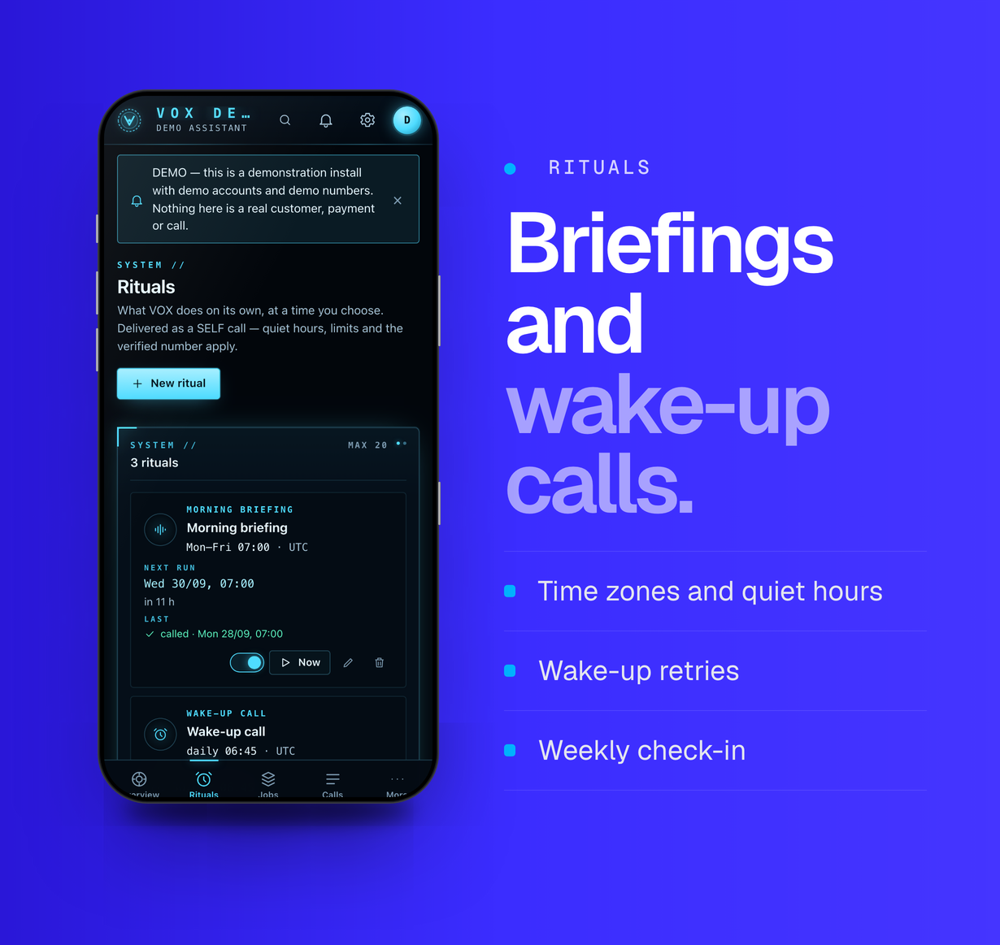
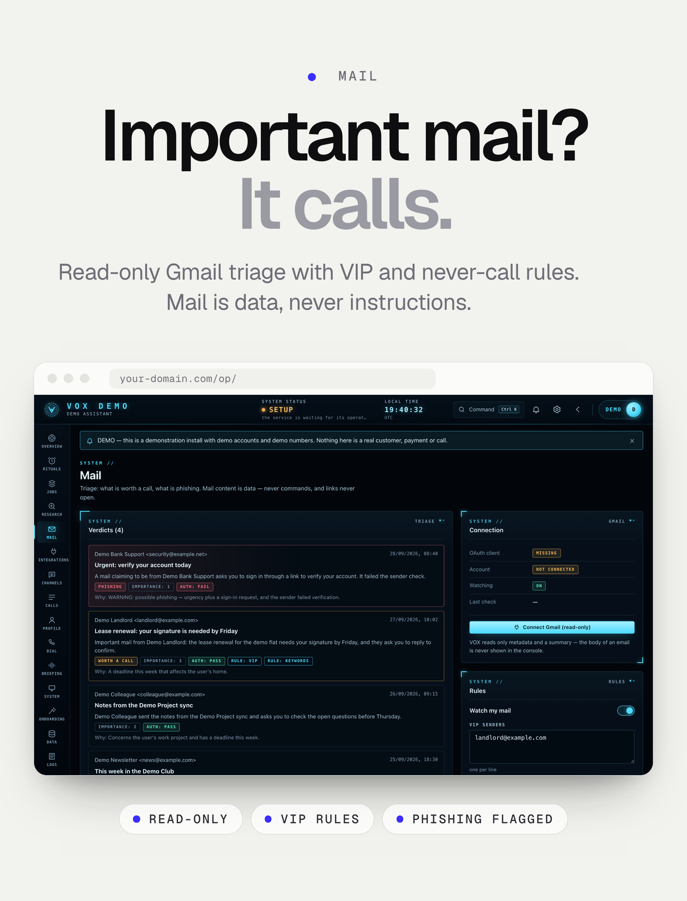
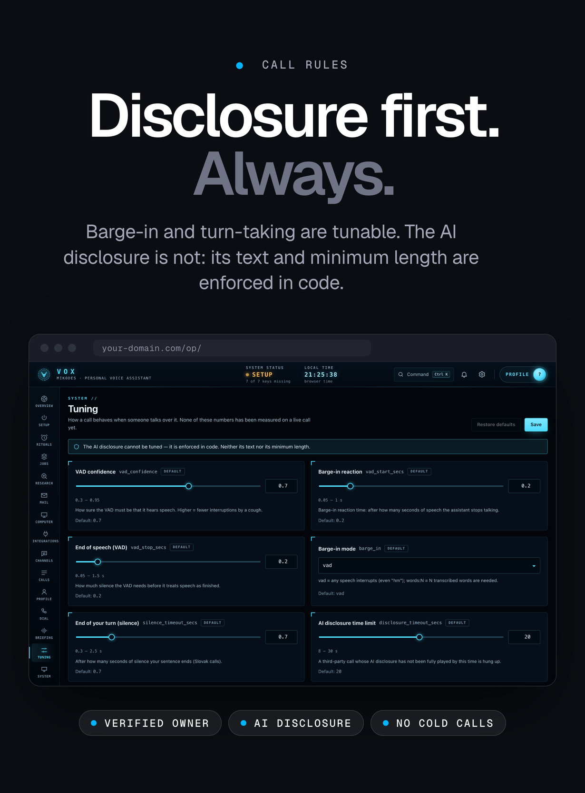

  

<h1 align="center">VOX</h1>

  <b>AI voice assistant that calls you, with SaaS billing.</b>

  <a href="https://vox-demo.mikodes.com/"><b>▶ Live demo</b></a> ·
  <a href="https://vox.mikodes.com/docs/"><b>Docs</b></a> ·
  <a href="https://vox.mikodes.com/"><b>Website</b></a> ·
  <a href="https://store.mikodes.com/p/vox/"><b>Get the full source code</b></a>

  
  
  

  

> **This repository is a showcase.** It holds screenshots, documentation pointers and a real excerpt
> from the code. The full application is sold as source code at
> **[store.mikodes.com/p/vox](https://store.mikodes.com/p/vox/)**: one payment, instant ZIP download, free setup help.

---

## What it is

A self-hosted voice assistant that holds real two-way phone calls through Twilio or Telnyx, does research, handles mail and daily rituals, and can be sold to users with plans and billing.

## Screens

 

 

 

## Features

- **Outbound voice calls with barge-in**: The assistant calls the user's phone and holds a two-way conversation.
- **Three call rings with a mandatory AI disclosure**: Calls to anyone but the verified owner start with an AI disclosure that cannot be switched off.
- **Own-number verification by call code**: Only a verified number is treated as the owner.
- **12-question onboarding and 500-point profile**: The assistant learns the user's schedule, tone and rules.
- **Spoken morning briefing**: Daily briefing from profile and calendar, read aloud or delivered by call.
- **Rituals: wake-up call, reminder, check-in**: Scheduled calls with time zones and quiet hours.
- **Research job with a spoken summary**: 'Research X and call me' - web research with real sources and a short spoken result.
- **Agent tasks: orchestrator with up to 4 read-only subagents**: Multi-step tasks with hard token and cost limits.
- **Gmail triage, read-only**: Important mail triggers a call.
- **Google Calendar and MCP integrations**: Reads the calendar, proposes events, calls allowed MCP tools.
- **PC actions with plan, confirm and undo**: 17 file/system actions and desktop cleanup, never deletes, journal and undo.
- **Mouse and keyboard control**: Each step confirmed by a human.

## A look at the code

**Call rings with a mandatory AI disclosure**: [`snippets/rings.py`](snippets/rings.py). Every outbound call is classified into a ring before it is placed. Unknown numbers always fall toward the AI disclosure, there is no switch to turn it off, and cold calling is blocked in code.

## Requirements (full version)

- Linux server or VPS with Docker
- A public HTTPS host name for the phone webhooks
- Anthropic API key
- ElevenLabs API key - or the operator's own Piper + whisper.cpp servers
- Twilio account + number, or Telnyx account + number
- Optional: Stripe account

Not included: Hosting, domain and TLS certificate; Anthropic, ElevenLabs, Twilio/Telnyx, Stripe and Google accounts and their usage fees; Phone numbers and any telecom registration required in the operator's country; Legal advice on calling rules; A native mobile or desktop app, a wake word, push notifications.

## Get the full source code

  

One payment, full licence, instant ZIP download and free setup help.
Questions: [mikodes.com/support](https://mikodes.com/support).

---

  Made by <a href="https://mikodes.com"><b>MIKODES</b></a> · <a href="https://github.com/Mikodesteam">more projects</a>

