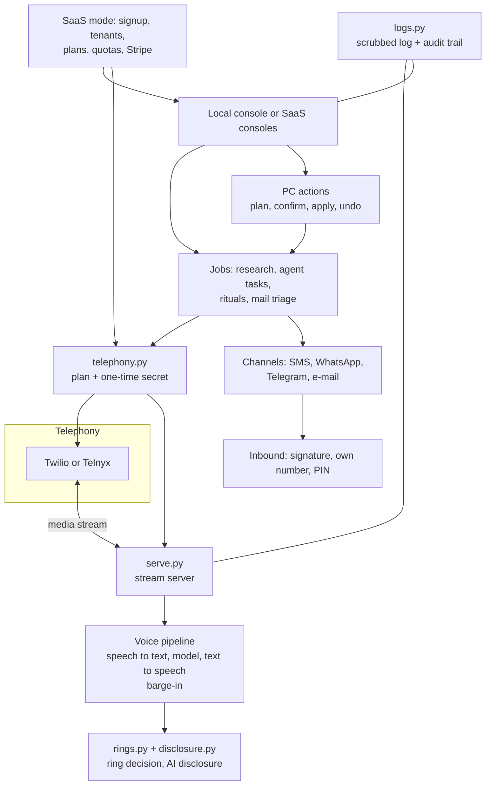

# How VOX works

An engineering write-up of VOX, a voice assistant that makes and receives real phone calls for its owner: it calls you, takes instructions by voice, researches, triages mail and acts on your computer, all behind explicit confirmation rules. It describes what the code does and why. The full source is sold separately (link at the end); only a few excerpts are public.

## Reading order

If you only have five minutes, read "Key engineering decisions" and the three excerpts in [`../snippets/`](../snippets/): [`rings.py`](../snippets/rings.py), [`playout_marks.py`](../snippets/playout_marks.py) and [`code_verification.py`](../snippets/code_verification.py). None of them is a working module on its own.

## The problem and who it is for

A phone call is the most universal interface there is, but voice assistants that live inside a speaker or a phone app cannot call you at 7:00, brief you, remind you, or run a research job and read you the summary. VOX does that over a normal phone line, with a Claude model deciding what to say and a speech layer handling the conversation, including interruptions. It is for individuals who want a personal phone assistant, and for operators who want to resell it as a branded service with accounts, plans and billing.

Because it uses a real phone network, the code is as much about restraint as capability: who may be called, what the callee must hear first, what the assistant may do without asking, and what it must never do.

## Architecture

A Python service (FastAPI and a real-time audio pipeline) is the core. A small Node CLI handles first-run onboarding. Everything is stored as owner-only files or SQLite. The consoles are static HTML, CSS and JavaScript with no build step and no CDN.

Main parts:

- **Telephony** (`telephony.py`, `serve.py`): places calls through Twilio or Telnyx and accepts the audio stream when the call is answered. Both providers are built through the same code path for ring, disclosure, tools and budget.
- **Rings and disclosure** (`rings.py`, `disclosure.py`): decide what kind of call this is and make sure the callee hears the AI disclosure first.
- **Jobs** (`jobs/`): research, agent tasks with read-only subagents, rituals (wake-up call, reminder, check-in), Gmail triage, desktop tasks.
- **PC actions** (`pc/`): a catalogue of things VOX may do on the owner's computer, each planned, confirmed, journaled and undoable.
- **Channels** (`channels/`): SMS, WhatsApp, Telegram and e-mail to the owner, plus inbound SMS and calls from the owner.
- **Consoles**: a local console with a setup wizard and live key tests, and, in SaaS mode, a public site, sign-up, per-tenant consoles and an operator panel.
- **Billing** (`saas/billing/`): plans, usage quotas, prepaid credits, Stripe checkout and a signed webhook.

## One flow, step by step: VOX places a call for a third party

1. **Decide the ring, in code.** The request carries a number and a purpose. `rings.py` classifies it: SELF (the user's own verified number), THIRD (anyone else) or COLD (campaign dialling, which raises an error and is not implemented). A call asked for as SELF is only SELF if the dialled number really is the number on the profile; anything else is demoted to THIRD (see [`../snippets/rings.py`](../snippets/rings.py)).
2. **Check the language.** A call can only be placed in a language for which a disclosure text exists; there is no silent fallback to another language.
3. **Check quota and permissions.** In SaaS mode the tenant's plan decides whether third-party calls are allowed at all, and how many call seconds remain. The check and the usage record can be taken in one database transaction so two workers cannot both spend the last unit.
4. **Write a plan, then dial.** The ring, number, purpose and a one-time secret are written to a plan file before the provider is contacted. The secret travels to the provider over its authenticated REST API and returns as a parameter of the media stream.
5. **Accept the stream only if it proves itself.** When the call is answered, the provider connects to the stream server. The server accepts it only when a plan exists for that call identifier, the secret and the operator's account identifier match, and the plan has not been claimed before. The claim is atomic. Otherwise the server hangs up without a word.
6. **Mute the callee until the disclosure is heard.** On a THIRD call the assistant speaks the disclosure first, and the callee's audio is ignored until it has been played. "Played" is measured on audio, not on time (see decision 2 below).
7. **Only then the conversation.** The model is not run until the disclosure is confirmed complete. During the call the plan's tools are available; a call that starts from an automated callback is marked "tainted" from the start, and a tainted conversation never gets to plan mouse or keyboard actions.
8. **Budget and cut-off.** In SaaS mode the call carries the tenant's remaining minutes as a budget. When they run out the assistant says a fixed closing line and hangs up, on a third-party call only after the disclosure was heard, never in the middle of it.
9. **Record.** The transcript, the usage record and the audit entry are written; log lines are scrubbed before they are written.

## Key engineering decisions

### 1. The call ring is structural, not a setting

*Chosen:* three rings enforced in code, with the disclosure attached to the THIRD ring and no parameter that removes it. Unknown numbers always fall toward disclosure; COLD is a hard error. *Alternative:* a configuration flag such as "disclose AI: on/off". *Why:* a flag can be turned off by someone who does not understand the consequences (the code comments cite the EU AI Act and US telemarketing rules), and a flag in a product that is sold as source is a flag buyers will flip. If a future code path could disable the disclosure, the comment says it is a bug.

### 2. "Heard" is measured by the provider's echo, not by a timer

*Chosen:* the server sends a marker right behind the disclosure audio and counts the disclosure heard only when the telephony provider echoes that exact marker, which it does once the preceding audio has been played to the callee. The echo is accepted once, only for the right stream, and only for a marker that was really sent (see [`../snippets/playout_marks.py`](../snippets/playout_marks.py)). For a provider that is not relied on to echo markers, a timed variant counts the disclosure heard a fixed pad after its last audio was written: later, never earlier. *Alternative:* trust wall-clock time or the "bot stopped speaking" event. *Why:* when the text-to-speech audio stalls, "stopped speaking" is reported after a silence timeout that must not pass for speech. The disclosure also has to be complete: a minimum amount of audio and a "finished" signal from the speech engine are both required, and an error before completion does not release the mute (a library default would). If it did not play, the call does not continue and the deadline hangs up.

### 3. Plan, confirm, apply, journal, undo for anything that touches the computer

*Chosen:* every action in a fixed catalogue either reads (and is recorded) or produces a stored preview and does nothing until confirmed. Confirming re-plans with the same parameters and refuses if the operations differ from what the human saw; a journal file is created exclusively, so a plan can be applied once, ever; each operation is re-validated right before it happens; changes can be undone by replaying the journal backwards. *Alternative:* let the model call tools directly. *Why:* a model reading an e-mail or a web page can be talked into things. Here nothing read ever reaches the planner as an instruction, there is no shell, no URL opening and no deletion or overwrite, paths are limited to allowed roots, and mouse and keyboard control is off until the operator turns it on, always needs confirmation and is never undoable.

### 4. Agents with read-only tools and a hard budget

*Chosen:* an orchestrator splits a request into a few subtasks, each run by a subagent that has a narrow, read-only tool allowlist; the orchestrator composes one spoken summary from what they found. A subagent that thinks something should be done can only record a proposal that needs confirmation. Limits are enforced in code: number of subagents, model turns, tool calls and a per-job token and cost budget checked before every model call, with a reserve kept back for the final summary. *Alternative:* a general agent framework with open tool access. *Why:* a runtime dependency on a bundled proprietary binary is a poor fit for source sold to buyers, and a budget the model is merely asked to respect is not a budget. Model choice is routed by task: a stronger model for orchestration and web research, a cheaper one for reading the owner's own calendar, mail verdicts and tool output.

### 5. Schedules that prefer missing a call to doubling one

*Chosen:* rituals are wall-clock times in an IANA time zone; the instant is computed per local date, a non-existent local time shifts forward by the gap and an ambiguous one takes the first occurrence. Each occurrence is marked as fired before the job is created, so a crash can lose one call but cannot duplicate one. An occurrence found too late is recorded as missed. A ritual never dials by itself; it creates a job that goes through the same checks as any other call (verified own number, permission, quiet hours, rate limit). *Alternative:* a naive cron-like interval. *Why:* a wake-up call at 11:00 instead of 7:00 is worse than none, and a duplicated call at night is worse than a missed one.

### 6. One store, two modes

*Chosen:* the same code runs as a single-owner console or as a multi-tenant service; in SaaS mode everything of a call (plan, claim, profile, transcript, jobs) comes from the tenant's own directory, found through an index written at dial time and never read off the stream. *Alternative:* two code bases. *Why:* the safety rules in the call path must be identical in both.

## Security and safety measures that exist in the code

- **No cold calling.** The ring that would allow it raises an error; the comment documents why.
- **AI disclosure with no off switch** on third-party calls, with a language check and a parity test between the Python and JavaScript copies of the text.
- **Own-number verification.** A phone number or a chat or mailbox only counts as the owner's after a read-back code: six digits, only a salted hash stored, ten-minute expiry, five attempts, constant-time comparison (see [`../snippets/code_verification.py`](../snippets/code_verification.py)).
- **Streams must prove they are ours:** a one-time secret, the operator's account identifier and an atomic claim; knowing a call identifier is not enough. The stream server hangs up silently on any refusal and on any error before the pipeline runs.
- **Inbound requests:** the provider's request signature is validated against the configured public host first (403 otherwise), then the account, then the sender must be the owner's verified number. Calls need a PIN, wrong PINs lock the line (five in an hour, ten in a day), SMS actions are rate-limited, and message text is matched against a fixed list of commands deterministically: no model reads it to decide what to do, numbers in it are never dialled and links are never opened.
- **Provider webhooks** from Telnyx are verified with Ed25519 signatures.
- **Logs:** a single JSON log file with owner-only permissions, rotation, no variable values in tracebacks, and scrubbing of every configured key value plus known token shapes (and spoken verification codes) before a line is written and again when it is read. An admin audit trail records who, what, when and the route, never a body or a value.
- **Web console:** strict content security policy and security headers on every response, no caching of API answers, and a double-submit CSRF header on every state-changing request.
- **Billing:** top-ups are granted at most once per checkout session; a client never sends an amount; the credit table is append-only; webhook signatures are verified.
- **Data rights:** export and delete endpoints for personal data.
- **Optional local speech** (a local text-to-speech and a local speech-to-text engine) so audio can stay on the operator's server.

## Details worth a closer look

### Numbers fixed in code

| What | Value | Where |
|---|---|---|
| Read-back code | 6 digits, 10-minute expiry, 5 attempts | Channel and number verification |
| Disclosure speech floor | at least 0.25 s of audio per word | Disclosure meter |
| Time allowed for the speech engine to report "finished" | 1.0 s after "bot stopped speaking" | Disclosure meter |
| Extra wait for a provider without playback echo | 1.5 s after the last audio was written | Timed playout |
| Pending PC plan lifetime | 24 hours | Plan engine |
| Plan identifier format | "P" and 12 hex characters, checked before any file access | Plan engine |
| Log file | rotated at 1 MB, 5 old files kept, mode 0600 | Logging |
| Audit trail | one line per admin action, capped at 2 MB | Logging |
| Inbound call PIN lockout | 5 wrong in an hour locks for an hour; 10 in a day locks until the owner unlocks | Inbound channel |

### Why the plan identifier is validated first

Every PC action plan is a file named after its identifier. The engine checks the identifier against a strict pattern before building a path from it, so a request cannot reach outside the plans folder by naming a "plan" with path characters in it. Plan files are written atomically with owner-only permissions, and confirming takes an exclusive per-plan lock so two confirmations cannot both apply.

### Spoken text is a leak path too

The speech engine logs every text it speaks at debug level. A verification code that is spelled out ("4, 8, 2, ...") would therefore appear in the console log, which would make the phone check prove nothing. The log scrubber has a pattern for exactly this shape, alongside patterns for API keys, bearer tokens, bot tokens and key=value pairs.

### Credits are counted units, never money

Prepaid credits are units of a counted kind (call seconds, research jobs, text messages), and a balance is the sum of append-only rows from three sources: an operator grant, a verified paid checkout and usage. Plan limits for the period are consumed first, then credits, then nothing. The price of a pack is read on the server when the checkout is created, never accepted from the client.

### Provider independence

Twilio and Telnyx streams are separate endpoints with separate claims: a stream for one provider can never claim the other's plan. Ring and disclosure rules are decided before the provider is even looked at, so they cannot differ between providers.

## How you would build something like this

1. **Start with the telephony loop.** Place a call, accept the stream, play one phrase, hang up. Prove the stream is yours (one-time secret, atomic claim) before you add any intelligence.
2. **Decide the legal and ethical rules as code, early.** Who may be called, what is said first, what is impossible. Make the rules impossible to configure away, and write tests that fail if a code path skips them.
3. **Add the conversation pipeline:** speech to text, a model, text to speech, and barge-in. Then fix the interaction between barge-in and your mandatory first sentence, because they conflict by default.
4. **Measure playback honestly.** Use the provider's playback acknowledgement where it exists, and a conservative delay where it does not.
5. **Add capabilities one at a time, each with a plan/confirm/undo shape,** and treat everything the assistant reads (mail, pages, file names) as data inside a fence, never as an instruction.
6. **Give background work a budget in code:** limits on turns, tool calls, tokens and cost, checked before each call.
7. **Make scheduling pessimistic:** persist "fired" before acting, record missed occurrences instead of late ones, and test around daylight-saving changes.
8. **Only then turn it into a service:** tenants, plans, quotas that are checked and recorded in one transaction, prepaid credits, and a payment provider whose webhooks you verify.

## Deployment and customization

- Runs on a Linux server or VPS with Docker, or with Python 3.11 or newer and Node.js 20 or newer through the supplied installer, with example service files and reverse-proxy configurations for a public HTTPS host name (the phone provider's webhooks need one).
- The operator brings their own keys: an Anthropic key, a speech provider key (or local speech servers) and a Twilio or Telnyx account with a number. Keys are entered in the console, which tests them live, or supplied through the environment; none are in the source.
- In SaaS mode the operator panel sets plans, usage quotas, credit packs, branding and margin; the public site, pricing page and legal pages are static files that can be edited.
- Integrations (Google Calendar, read-only Gmail triage, MCP servers) and the channels to the owner are set up in the console; the call rings and the disclosure are not configurable.

Full source code, docs and setup help: https://store.mikodes.com/p/vox/
